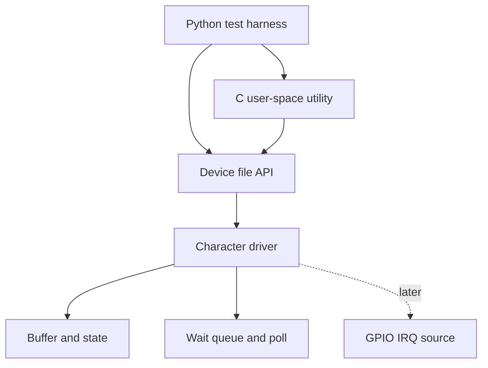

# Linux Character Device Driver and Python Test Harness

> **Status: Repository scaffold — implementation in progress.**
> No kernel module, interrupt path, test result, or hardware behavior is presented as complete until its source code and repeatable evidence are committed.

This repository is the development workspace for learning Linux character-device development in C and building a Python test harness around a stable user/kernel ABI. The project will begin with a software-only device and introduce GPIO interrupts only after the basic file operations, blocking behavior, and tests work reliably.

## Project objective

Build the project incrementally while learning and demonstrating:

- Linux kernel-module structure and safe initialization/cleanup;
- character-device registration and file operations;
- data exchange through `read`, `write`, `ioctl`, and `poll`;
- wait queues, locking, bounds checking, and error handling;
- user-space C utilities and Python automation;
- reproducible negative, boundary, concurrency, and fault-injection tests;
- hardware interrupt handling only on a documented target platform.

## Planned feature matrix

| Area | Planned capability | Current status |
|---|---|---|
| Build setup | Reproducible out-of-tree kernel-module build | Not started |
| Module lifecycle | Safe load, unload, and cleanup | Not started |
| Device registration | Character or miscellaneous device registration | Not started |
| Basic I/O | Bounded `read` and `write` operations | Not started |
| Control API | Versioned `ioctl` commands with shared headers | Not started |
| Event notification | Blocking reads, wait queues, and `poll`/`select` support | Not started |
| Concurrency | Correct locking and multi-process behavior | Not started |
| C client | User-space exerciser for the public ABI | Not started |
| Python harness | Automated functional and negative tests | Not started |
| Logging | Timestamped test reports and serial-log integration | Not started |
| Fault testing | Invalid arguments, interruption, timeout, and recovery tests | Not started |
| GPIO interrupt | Platform-specific IRQ path with documented hardware | Not started |

## Planned architecture



The initial milestones are software-only and can be completed in a Linux virtual machine or native Linux installation. The GPIO interrupt milestone requires a supported Linux board, its exact kernel documentation, schematic, device-tree configuration, and safe electrical setup.

## Repository structure

```text
kernel/             Planned kernel-module sources
include/            Planned shared UAPI definitions
userspace/c/        Planned C client and diagnostic utilities
tests/python/       Planned Python automated test harness
tests/hardware/     On-target procedures and captured evidence
docs/               Architecture, milestones, and design decisions
```

## Development sequence

1. Record the host distribution, kernel version, compiler, and headers.
2. Build and load a minimal module with verifiable cleanup.
3. Register one device node and implement bounded basic I/O.
4. Define a small versioned ABI and add `ioctl` validation.
5. Add blocking behavior, wait queues, and `poll` support.
6. Add locking and test concurrent access from multiple processes.
7. Build C and Python clients with positive and negative tests.
8. Add fault injection and structured test reports.
9. Add a GPIO interrupt only after selecting and documenting the target hardware.

See [ROADMAP.md](docs/ROADMAP.md) for milestone acceptance criteria and [PROJECT_STATUS.md](PROJECT_STATUS.md) for the current verified state.

## Evidence policy

A feature may be marked complete only when the repository contains:

- the relevant source code;
- exact build and execution instructions;
- a repeatable test procedure;
- observed logs or test output with environment details;
- cleanup/recovery behavior and known limitations.

Generated placeholders, plans, and unexecuted code are not evidence of a completed driver.

## Safety note

Kernel bugs can freeze or crash a system. Early work should be performed in a disposable virtual machine or on a non-critical development target. Hardware GPIO/IRQ work must use the exact board documentation and safe voltage levels.
